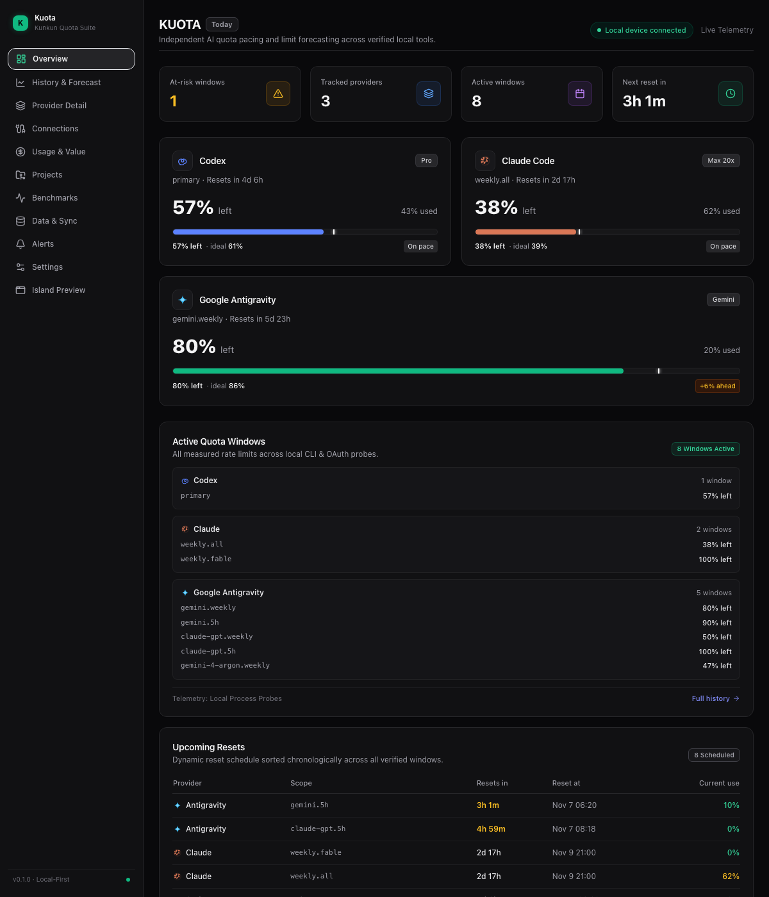
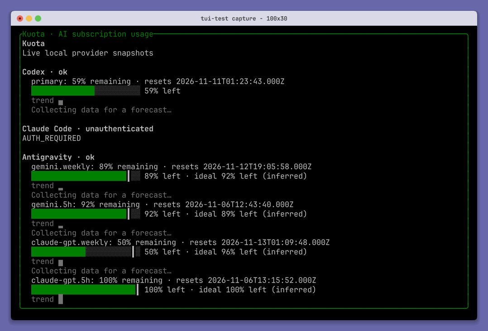
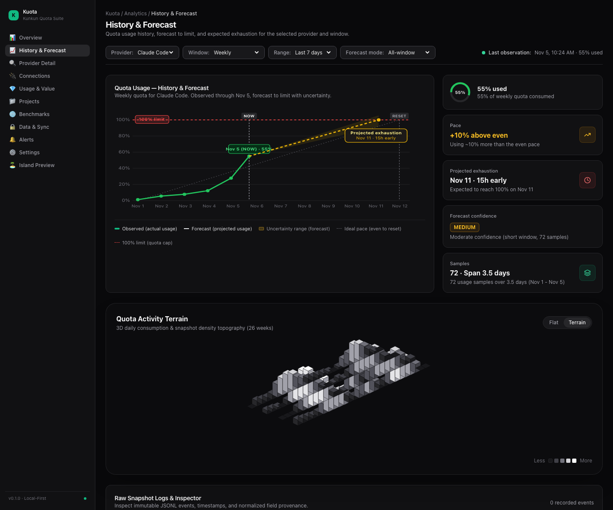
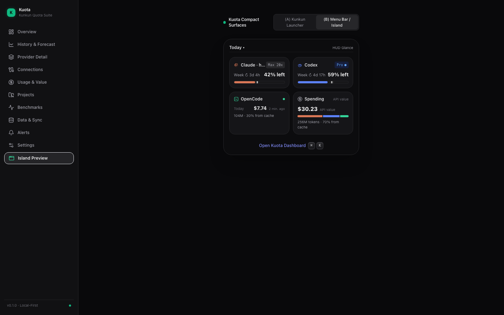

# Kuota

<div align="center">

**真实、透明的多平台 AI 额度监控与智能预算看板**
<br />
**Truthful Multi-Provider AI Subscription & Quota Dashboard**

[](https://github.com/kunkunsh/kuota/releases)
[](https://github.com/kunkunsh/homebrew-tap)
[](https://www.npmjs.com/package/@kunkun.sh/kuota)
[](https://github.com/kunkunsh/kuota/actions/workflows/ci.yml)
[](LICENSE)

[English](README.md) · [🇨🇳 简体中文](README.zh-CN.md)

<br />



_Kuota Desktop App: Real-time quota balance, time budget pacing, and multi-provider telemetry across Claude Code, OpenAI Codex, and Google Antigravity._

</div>

---

## ⚡️ Key Features

- 🎯 **Truthful Quota Pacing**: Computes actual remaining budget against ideal time pacing without guessing or hallucinating missing official metadata.
- 🤖 **Multi-Provider Unified Hub**: Native first-class adapters for **Claude Code**, **OpenAI Codex**, and **Google Antigravity**.
- 🖥 **Four Ergonomic Surfaces**:
  - **Native Desktop App (Tauri v2)**: Lightweight, ultra-fast macOS / Windows / Linux desktop dashboard with native draggable titlebar and dark/light themes.
  - **Terminal TUI**: Keyboard-navigated fullscreen terminal dashboard with real-time refresh.
  - **Web Workbench**: Embedded loopback HTTP server + React 19 UI with 3D activity terrain and Dynamic Island.
  - **Headless CLI & Library**: Scriptable JSON/text output for scripts, dotfiles, and CI.
- 🔒 **Local-First & Zero Cloud Leak**: Direct reads from local tool CLIs, OAuth credentials, and local RPC — zero telemetries sent to third-party servers. Cross-process caching powered by SQLite WAL.

---

## 📥 Installation

### 1. Homebrew (macOS Cask - Recommended)

Install Kuota Desktop directly via [kunkunsh/homebrew-tap](https://github.com/kunkunsh/homebrew-tap):

```bash
brew install --cask kunkunsh/tap/kuota
# or
brew install --cask HuakunShen/tap/kuota
```

To update to the latest release:

```bash
brew upgrade kuota
```

> **Note on macOS Gatekeeper**: The app supports auto-updates via Tauri MiniSign signatures. If installing manually without brew, click _Open Anyway_ under System Settings → Privacy & Security on first launch.

### 2. Direct Desktop Download

Pre-built binaries for all major platforms are available on [GitHub Releases](https://github.com/kunkunsh/kuota/releases/latest):

| Platform                              | Download Asset                       |
| :------------------------------------ | :----------------------------------- |
| **macOS Apple Silicon** (M1/M2/M3/M4) | `Kuota_x.y.z_aarch64.dmg`            |
| **macOS Intel** (x86_64)              | `Kuota_x.y.z_x64.dmg`                |
| **Windows**                           | `Kuota_x.y.z_x64-setup.exe` / `.msi` |
| **Linux (Debian / Ubuntu)**           | `kuota_x.y.z_amd64.deb`              |
| **Linux (Generic)**                   | `kuota_x.y.z_amd64.AppImage`         |

---

## 🚀 CLI & Terminal Usage

Run instantly with zero installation via `npx`:

```bash
# 1. Interactive terminal TUI (full-screen UniView dashboard)
npx @kunkun.sh/kuota tui

# 2. Web Workbench (local loopback server + modern UI)
npx @kunkun.sh/kuota web

# 3. Headless CLI status check (formatted text or JSON)
npx @kunkun.sh/kuota status
npx @kunkun.sh/kuota status --json
npx @kunkun.sh/kuota doctor
npx @kunkun.sh/kuota pace
npx @kunkun.sh/kuota forecast
```

---

## 🖼 Gallery

<div align="center">

### Interactive Terminal TUI (`kuota tui`)



<br />

### History Pacing & Depletion Forecasting



<br />

### Compact Dynamic Island HUD



</div>

---

## 📦 TypeScript Library

Install as a dependency in your backend, CLI, or extension:

```bash
npm install @kunkun.sh/kuota
# or
bun add @kunkun.sh/kuota
```

```typescript
import { readAll, calculatePace } from "@kunkun.sh/kuota";
import { Effect } from "effect";

// Query all detected local providers:
const snapshots = await Effect.runPromise(readAll(["codex", "claude", "antigravity"]));

for (const snapshot of snapshots) {
  console.log(`Provider: ${snapshot.providerId} (${snapshot.accountScope ?? "default"})`);
  for (const win of snapshot.windows) {
    console.log(`  Window: ${win.windowId} -> ${win.usedPercent}% used, resets at: ${win.resetAt}`);
  }
}
```

---

## 🛠 Building From Source

Requirements: [Bun](https://bun.sh) (>= 1.2), [Rust](https://rust-lang.org) (stable), Node.js (>= 22).

```bash
# Clone the repository
git clone https://github.com/kunkunsh/kuota.git
cd kuota

# Install dependencies
bun install

# Verify typecheck, linter, and tests
bun run check
bun run typecheck
bun run test

# Run Web Workbench in development
bun run dev

# Run Desktop App in development
bun run desktop:dev

# Build all packages & desktop bundle
bun run build
bun run desktop:build
```

---

## 📄 License

[MIT](LICENSE) © 2026 [Kunkun](https://kunkun.sh) & Huakun Shen
