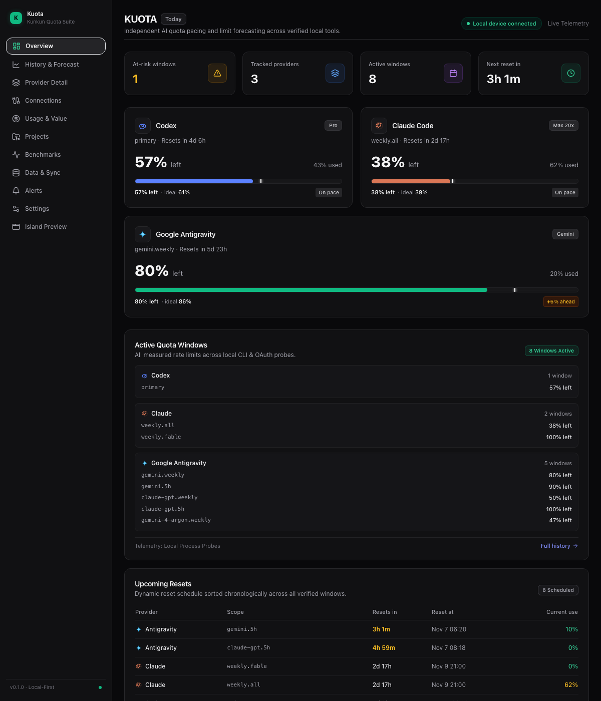
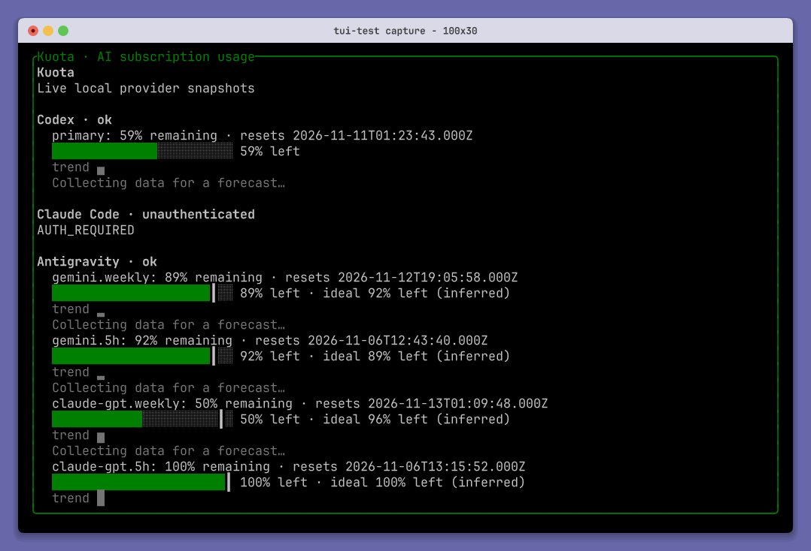
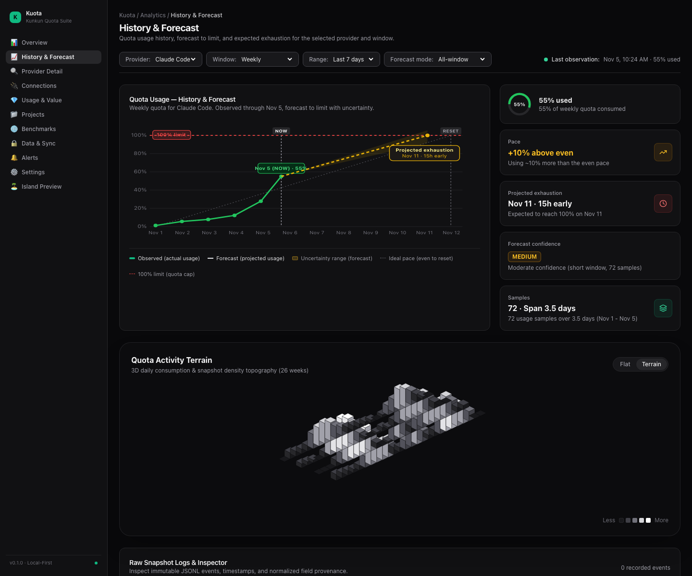
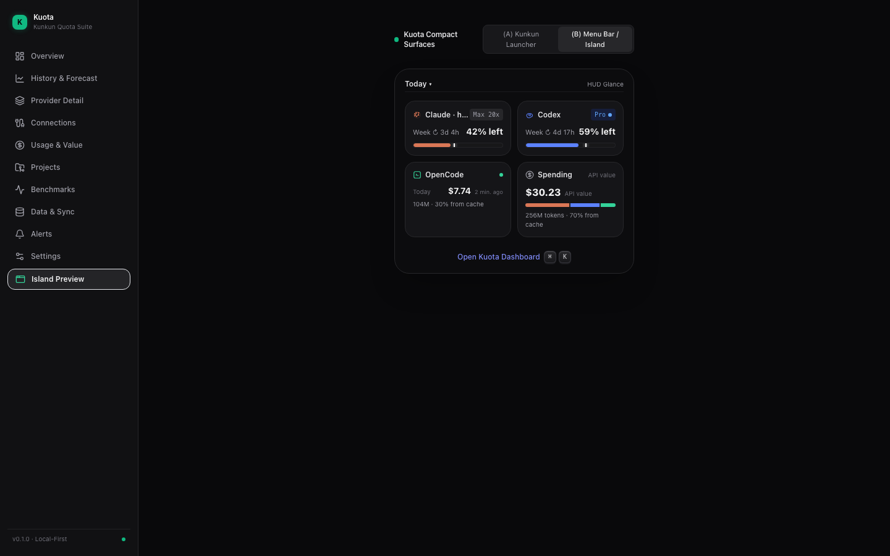

# Kuota

<div align="center">

**真实、透明的多平台 AI 额度监控与智能预算看板**
<br />
**Truthful Multi-Provider AI Subscription & Quota Dashboard**

[](https://github.com/kunkunsh/kuota/releases)
[](https://github.com/HuakunShen/homebrew-tap)
[](https://www.npmjs.com/package/@kunkun.sh/kuota)
[](https://github.com/kunkunsh/kuota/actions/workflows/ci.yml)
[](LICENSE)

[English](README.md) · [🇨🇳 简体中文](README.zh-CN.md)

<br />



_Kuota 桌面端：实时余量统计、时间节奏（Pace）对比、多模型统一遥测（Claude Code、OpenAI Codex、Google Antigravity）。_

</div>

---

## ⚡️ 核心特性

- 🎯 **真实透明的节奏追踪（Truthful Pacing）**：计算实际消耗与理想时间进度的偏差，严禁对官方未提供的数据（如滚动窗口起点）进行脑补或伪造。
- 🤖 **多厂商统一聚合**：首发深度适配 **Claude Code**、**OpenAI Codex** 和 **Google Antigravity**，支持多窗口（5小时会话、周度、月度）分层展示。
- 🖥 **四大体验形态**：
  - **原生桌面 App (Tauri v2)**：极速轻量的 macOS / Windows / Linux 独立客户端，支持原生无边框拖拽标题栏与深色/浅色自适应主题。
  - **终端 TUI (UniView)**：全键盘交互的现代化终端面板，纯本地渲染。
  - **Web 工作台 (Workbench)**：内置 Loopback HTTP 服务与 React 19 SPA，提供 3D 活动地貌与灵动岛 HUD 视图。
  - **Headless 命令行与库**：支持标准输出与 JSON 格式，方便整合进脚本、自动化任务及 CI。
- 🔒 **本地优先与零云端泄露**：只读取本地工具的 CLI、本地凭证或本地 RPC 接口，绝不上传你的配额数据。跨进程并发保护与 429 冷却锁基于本地 SQLite WAL。

---

## 📥 安装指南

### 1. Homebrew 安装（macOS 推荐）

通过 [HuakunShen/homebrew-tap](https://github.com/HuakunShen/homebrew-tap) 一键安装 Kuota 桌面客户端：

```bash
# 安装桌面端应用
brew install --cask HuakunShen/tap/kuota
```

后续更新：

```bash
brew upgrade kuota
```

> **macOS 安全提示**：Kuota 桌面客户端内置基于 Tauri MiniSign 的自动增量更新。如果是直接下载 DMG 安装，首次打开时若提示未受信任开发者，可在「系统设置 → 隐私与安全性」中点击「仍要打开」即可。

### 2. GitHub Releases 独立安装包下载

各平台安装包可在 [GitHub Releases 页面](https://github.com/kunkunsh/kuota/releases/latest) 直接下载：

| 平台                                  | 安装包名称                           |
| :------------------------------------ | :----------------------------------- |
| **macOS Apple Silicon** (M1/M2/M3/M4) | `Kuota_x.y.z_aarch64.dmg`            |
| **macOS Intel** (x86_64)              | `Kuota_x.y.z_x64.dmg`                |
| **Windows**                           | `Kuota_x.y.z_x64-setup.exe` / `.msi` |
| **Linux (Debian / Ubuntu)**           | `kuota_x.y.z_amd64.deb`              |
| **Linux (通用 AppImage)**             | `kuota_x.y.z_amd64.AppImage`         |

---

## 🚀 命令行与快速体验（免安装）

无需全局安装，使用 `npx` 即可随时调用：

```bash
# 1. 启动终端全屏交互 TUI 面板
npx @kunkun.sh/kuota tui

# 2. 启动 Web 工作台（自动打开本地浏览器）
npx @kunkun.sh/kuota web

# 3. 命令行静默查询（支持纯文本与标准 JSON 输出）
npx @kunkun.sh/kuota status
npx @kunkun.sh/kuota status --json
npx @kunkun.sh/kuota doctor
npx @kunkun.sh/kuota pace
npx @kunkun.sh/kuota forecast
```

---

## 🖼 软件界面一览

<div align="center">

### 终端交互 TUI (`kuota tui`)



<br />

### 历史额度消耗与耗尽预测



<br />

### 精简灵动岛 HUD 视图



</div>

---

## 📦 TypeScript 核心库使用

可将 Kuota 作为依赖集成进自建服务、脚本或 Kunkun 插件：

```bash
npm install @kunkun.sh/kuota
# 或
bun add @kunkun.sh/kuota
```

```typescript
import { readAll, calculatePace } from "@kunkun.sh/kuota";
import { Effect } from "effect";

// 一次性读取本地所有可用 Provider
const snapshots = await Effect.runPromise(readAll(["codex", "claude", "antigravity"]));

for (const snapshot of snapshots) {
  console.log(`供应商: ${snapshot.providerId} (${snapshot.accountScope ?? "default"})`);
  for (const win of snapshot.windows) {
    console.log(`  窗口: ${win.windowId} -> 已使用 ${win.usedPercent}%, 重置时间: ${win.resetAt}`);
  }
}
```

---

## 🛠 本地开发与源码编译

环境要求：[Bun](https://bun.sh) (>= 1.2), [Rust](https://rust-lang.org) (stable), Node.js (>= 22)。

```bash
# 克隆仓库
git clone https://github.com/kunkunsh/kuota.git
cd kuota

# 安装依赖
bun install

# 执行代码风格校验、类型检查与全套测试
bun run check
bun run typecheck
bun run test

# 启动 Web 工作台本地热重载开发
bun run dev

# 启动桌面端 (Tauri v2) 开发模式
bun run desktop:dev

# 全量构建所有模块与桌面安装包
bun run build
bun run desktop:build
```

---

## 📄 开源许可

本项目遵循 [MIT](LICENSE) 开源协议。
© 2026 [Kunkun](https://kunkun.sh) & Huakun Shen
