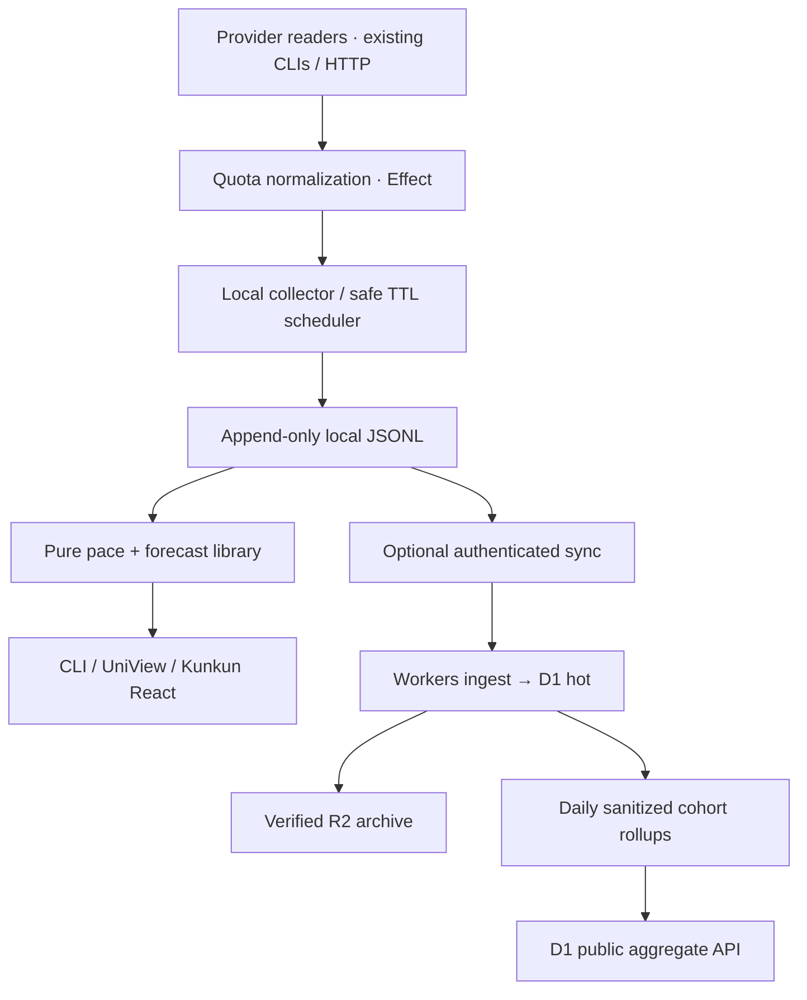

# Kuota History, Pacing, Forecast, Cloud Sync & Research Pool — Technical Specification

> Date: 2026-11-06 · **PROPOSED / NOT IMPLEMENTED** · Related UX: `2026-11-06-kuota-dashboard-ux.md`  
> Architecture inputs: existing `@kuota/core`, `@kuota/providers`, `@kuota/cli`, `@kuota/tui`; current CLI JSON `schemaVersion:1` must remain intact.

## 0. Executive decision

- **Build now:** zero-cloud `ideal pace` white tick, local append-only observed snapshots, a versioned `history` API, pure pace and simple forecast calculators, one UniView TUI view. This is useful even when Kunkun is offline.
- **Next:** Kunkun permissioned scheduled collection, optional private Kunkun Cloud sync, dashboard, alerts.
- **Later and opt-in:** privacy-safe community benchmarks, effective token-cap estimation, API/MCP distribution, Project/WakaTime integrations. **Do not build a permanent OLAP service initially.**
- **Storage:** local `JSONL` MVP with rotation and lock; optional SQLite index on need. For cloud history: Workers ingest → D1 current window/hot history → immutable R2 archived segments. Daily bounded aggregations in D1, batch DuckDB+Parquet only when cohort analysis justifies it.
- **Pricing/privacy:** personal local capability free and no contribution required; paid Kunkun bundle adds cloud sync, retention, team/alerts/API. Community research is separately opt-in for free and paid members; opt-in users may earn community benchmark features. No "privacy ransom".

## 1. Observed quota vs theoretical pace

Define all internal chart axes in terms of quota **used** (`u = 100 - remaining` only when a valid remaining % is known). Given an unambiguously known fixed window start `s`, expected reset/end `e`, and now `t`:

```ts
type Quality = "exact" | "inferred" | "unsupported";
interface PaceMarker {
  usedPercent: number;
  idealUsedPercent: number;
  idealRemainingPercent: number;
  elapsedFraction: number;
  remainingHours: number;
  paceDeltaPoints: number; // actual used - ideal used
  paceRatio: number | null; // usedPercent / idealUsedPercent if denominator > 0
  quality: Quality;
}

function theoreticalPace(now: number, start: number, end: number, usedPercent: number): PaceMarker | null {
  if (!(Number.isFinite(now) && Number.isFinite(start) && Number.isFinite(end) && Number.isFinite(usedPercent))) return null;
  if (end <= start || now < start || usedPercent < 0 || usedPercent > 100) return null;
  const x = Math.min(1, Math.max(0, (now - start) / (end - start)));
  const ideal = 100 * x;
  return {
    usedPercent,
    idealUsedPercent: ideal,
    idealRemainingPercent: 100 - ideal,
    elapsedFraction: x,
    remainingHours: Math.max(0, end - now) / 3_600_000,
    paceDeltaPoints: usedPercent - ideal,
    paceRatio: ideal > 0 ? usedPercent / ideal : null,
    quality: "exact",
  };
}
```

**UI orientation:** If a bar fills according to **remaining** %, draw white tick at `idealRemainingPercent`; if it fills by **used** %, draw at `idealUsedPercent`. Explicit label ensures user knows what is being shown. With a 7-day fixed window and 3.5 days elapsed, ideal use is 50%. Actual 55% used = 5 percentage points faster than even pace; constant rate would exhaust at 7 / 1.1 = 6.36 days, about 15h before reset. This is a **pace heuristic**, not a statistically learned forecast.

**Critical caveat:** Seeing `resetAt` alone does not always reveal the start. A fixed calendar month may begin at a stated timezone boundary; a 7-day fixed cycle may start 7 days before reset *only if provider confirms this semantics*. A `rolling 5h` limit may replenish continuously, and `starts on first use` may not match calendar. Only show the tick when start is supported or a clearly labeled inferred start; otherwise `pace:unavailable`.

## 2. Historical sampling: not every percent drop is a reset

- Capture the **actual acquisition** timestamp, `fetchedAt`, not just upload/scheduler time. A one-hour scheduler receiving a cached 20-minute-old sample must not be counted as a new consumption event.
- Primary identity: provider, proven account key (or `unknown` session-scoped key), named window, source semantics, plan/version when safely known, window epoch `startAt/resetAt`, device ID. Never join unrelated agy accounts using only a guessed email.
- `quota_used_pct` is a measured **stock value**, not increments. Compute deltas only between comparable points, within one window epoch. Missing points stay missing; do not interpolate or backfill a device that was asleep.
- A fixed window reset is confirmed by provider reset epoch changes, not simply a downward percent change. Rolling windows can go down because earlier usage falls out; no naive projected exhaustion date in this state.
- Provider errors are events (`quota.unavailable`) but do not become 0% quota. Duplicate upload retries are idempotent via deterministic `eventId`.
- Adaptive schedule: 60m default for weekly/monthly; 10–15m while active for 5h if safe; no background private endpoint hammering. Separate provider success TTL and 429 cooldown. If OS sleeps, no fabricated catch-up observations.
- Local file per UTC calendar date or per provider+account date. Single writer and explicit advisory lock; append line + `\n`, fsync policy configurable, truncate/repair partial **last** line only after integrity review; rotate and gzip historical files; store manifest/checkpoint of journal offsets.
- Start JSONL for append/export. If user wants arbitrary range queries over years, add SQLite event index as a migration, not as a required dependency of core.

## 3. Typed history data contracts (new version; do not alter snapshot v1)

```ts
type ObservationKind = "quota_observed" | "quota_unavailable" | "usage_observed";
type QuotaWindowSemantics = "fixed" | "rolling" | "first_use" | "unknown";

interface QuotaHistoryEventV1 {
  schemaVersion: 1; // historical journal schema, distinct from CLI status schema
  kind: ObservationKind;
  eventId: string; // stable dedup key, no secret
  observedAt: string; // provider sample UTC
  recordedAt: string; // local journal append UTC
  provider: string;
  accountScope: string | null; // local opaque ID, not email; null if unverifiable
  deviceId: string; // local random identifier, redact before research upload
  windowId: string;
  epochId: string | null; // normalize fixed-window epoch/reset boundaries
  semantics: QuotaWindowSemantics;
  startAt: string | null;
  resetAt: string | null;
  usedPercent: number | null;
  remainingPercent: number | null;
  source: string; // known short enum/name only, not raw HTTP or CLI output
  state: "ok" | "partial" | "stale" | "error" | "unauthenticated";
  errorCode: string | null;
  // optional aggregate usage metrics ONLY when separately supported by provider
  usage?: {
    inputTokens?: number;
    outputTokens?: number;
    cacheReadTokens?: number;
    cacheWriteTokens?: number;
    model?: string;
    estimatedUsd?: number;
  };
}

interface QuotaForecastV1 {
  schemaVersion: 1;
  provider: string;
  windowId: string;
  computedAt: string;
  currentUsedPercent: number;
  idealUsedPercent: number | null;
  observedSpanHours: number;
  sampleCount: number;
  slopePercentPerHour: number | null;
  exhaustedAt: string | null;
  projectedUsedAtResetPercent: number | null;
  expectedTimeToLimitHours: number | null;
  mode: "all-window" | "recent-activity";
  quality: "insufficient" | "low" | "medium" | "high" | "unsupported";
  reasons: string[]; // sanitized stable codes; e.g. ROLLING_WINDOW_UNMODELED
}
```

An **append-only journal event ID** can be `sha256(localProviderKey + epoch + window + observedAt + normalizedValue)`; do not publish source fingerprint or accountScope. Avoid using deterministic hashes of email or OAuth token as supposedly anonymous IDs. Schema validation uses Effect Schema and rejects invalid dates/NaN/percent outside 0..100. Each data migration creates a new event schema version with backward readers.

## 4. Forecasting: staged, honest uncertainty

### v1 robust slope

1. Filter one provider+accountScope+windowId+epochId; fixed windows only, observations with `state=ok` or fresh partial with valid numbers.
2. Sort by `observedAt`, dedupe repeated source readings, and discard samples older than current epoch. Recompute rates from `Δused / Δhours` only where both points are trustworthy and delta nonnegative; reset/credit shifts break the segment.
3. Start with a **weighted robust median** of interval slopes, weighted by elapsed hours but cap one long gap at 6h so an unattended weekend cannot dominate. Future option: Huber regression with recency decay and uncertainty interval.
4. `exhaustedAt = t + (100-u)/slope` if `slope>epsilon`. `projectedAtReset = u + slope * max(0, reset-t)`. The slope and timestamp must carry mode, samples and quality.
5. If `slope~0`, mark "Stable at current activity" instead of "infinite quota"; if projected exhausted after reset, display "On pace" not false exact future timestamp.
6. Confidence policy proposal: `<3` distinct samples, `<2h` observed span = `insufficient`; `<24h` or `<10% used` = `low`; `1–3d` with ≥6 changes = `medium`; `≥3d` with ≥20 changes and low variability = `high`, conditional on fixed epoch and fresh sources. These are *heuristics*, not statistically calibrated probabilities; test with backtesting.
7. Backtest sliding cutoffs: forecast from the first 1h, 24h, 3d of each prior real window, compare error in exhaustion time/outcome vs full actual window. Publish MAE, false-warning frequency and calibration before claiming any numeric 80/95% interval.

### v2 recent vs all-window pace

For bursty AI usage, offer multiple **clearly named** scenarios: long-run slope from current epoch, recent 12h/24h slope, and active-time slope when reliable project events exist. Model weekday/weekend patterns only when user history covers multiple similar epochs. Avoid auto-switch to an optimistic scenario silently. For rolling windows with refill, separate time-decay model requiring event-level spend; until validated: `forecast:unsupported`.

### Effective subscription cap research

An exploratory estimate `effectiveTokenCap ≈ ΔtokenCount / (ΔquotaUsed/100)` is **valid only when** both deltas represent the same provider, paid subscription, account, model billing weights and quota epoch. Provider can weight models, cached and reasoning tokens differently; token counters can cover other contexts; plan/boosts may change. Show `effective tokens under the observed workload`, not "official weekly token cap". Require ≥10 percentage-point quota movement, enough samples, stable source/plan, exact usage attribution and report *range* across intervals. Do not publicly compare providers by raw tokens or infer a cap from unrelated local Codex/Claude usage logs. Cross-plan change alerts need many independent opt-in accounts and a robust matched model-mix cohort.

## 5. Proposed service boundaries and flow



- **Scheduling:** Cloudflare Worker cron is for cloud aggregation, not the user's sleeping Mac. Use `launchd`/Kunkun job scheduler/Windows Task Scheduler. `kuota collect --once` exits quickly, memory and CPU negligible relative to provider subprocess costs. Job interval jitter ±3m to prevent thundering herd, with exponentially backed-off 429.
- **Auth:** user requests private cloud sync only after Kunkun account auth. One Worker endpoint can accept multiple provider windows in one **batched payload**. Validate payload max size/rate cap, JWT/account binding, idempotency, payload version and timestamp skew; never accept raw OAuth token/cookie/path/prompt.
- **D1 table split:** persist one batched `observation_hot(user_id, device_id, batch_id, observed_at, snapshot_json)` **per device/hour**, even when it contains many provider-window records. The 14-day read path fetches hundreds of rows for one user then normalizes/filter windows in a shared TypeScript library. Additional small tables: `last_state`, `user_sync_checkpoint`, `archive_manifest`, `aggregate_daily` + provider/plan metadata. Start with one `(user_id, observed_at)` index and add another only when proven by query traces; indexes raise billable writes. This batched D1 representation is intentionally different from the local per-window JSONL event representation.
- **Cloud reads:** latest snap cached as narrow `last_state`, history up to 14d from D1 query with index + pagination; older range from signed/authenticated R2 segment via Worker; for long chart fetch daily rollups first, raw on zoom.
- **No raw research upload by default.** Private sync dataset remains per user. Separate `ResearchContribution` removes direct IDs and coarse-grains time/model plan; transformations should happen locally, verified again by server. Participation is explicit, logged as consent version; revoke future uploads immediately; group only at k-anonymous cohort level.

## 6. R2 cold archive and safe deletion

**R2 does not support appending to a remote JSONL object.** Concurrent `PUT` to the same key is last-writer-wins, so write **immutable** keys. Strategy:

1. Select a bounded finalized range of D1 hot rows (e.g. UTC day D-15), taking a high-water `event_id`/timestamp; a day remains mutable until finalized after upload grace period.
2. Write immutable `archive/private/user=<opaque>/date=YYYY-MM-DD/part-<batch-id>.jsonl.gz` (or parquet) with eventCount, schemaVersion, compressed SHA-256 and original byte size recorded separately. No credential or prompt data.
3. Read back metadata (and sample/full checksum depending size), persist `archive_manifest` state `verified` in D1 referencing exact key + hash + row count, ensure retrievability; only then mark D1 source rows eligible for deletion.
4. Delete D1 source rows in small idempotent chunks **after** a grace period, with checkpoint ledger and verification; no cross-service atomic transaction is assumed. On errors, retain duplicate rather than lose data.
5. Periodically audit manifest/object parity, orphan files, row-count gaps, exports and a recovery drill. R2 object lifecycle can expire files after user-selected retention **only after** the manifest and user-deletion policies account for it.

One archive file per user per day is easy for delete/export but yields millions of tiny files at large scale; for **research** pool, separately create date/provider/plan **compacted** Parquet partitions 1–100MB per file. Do not co-pack private user archives if users need individual deletion. For tiny per-user daily raw segments, gzip JSONL can be smaller/cheaper operationally than tiny Parquet row groups. R2 Standard is preferred over Infrequent Access unless actual retrieval patterns justify fees/minimum duration.

**Browser reading:** `hyparquet` pure JS can read Parquet; DuckDB-Wasm is another option. Browser R2 access requires authorized signed URL/proxy and CORS. For MVP, serve JSON chart aggregates (and optional newline JSON export) instead: simpler, smaller, avoids shipping a Wasm SQL engine into Kunkun WebView.

## 7. Analytics without an OLAP service

### Personal dashboard

For 14 days × 24 observations/day × N windows, a single user's D1 indexed query returns hundreds/thousands of points. The browser or Kunkun app can compute short-term slope and render charts locally. Older data is downsampled daily and loaded only on request. No always-on analytics DB.

### Research pool

Daily batch over **sanitized opt-in cohort data only**: group by `(day, provider, plan, window_kind, model_mix_bucket)` and compute n, median/p25/p75 of effective consumption and uncertainty. Store final compact public aggregates in D1. For low volumes, bounded D1 SQL aggregation in a scheduled Worker; when scan/cost becomes high, export sanitized events to R2 Parquet and run scheduled ephemeral DuckDB `read_parquet` with Cloudflare R2 S3 API from a job container, writing final D1 rows. No need ClickHouse/ClickHouse Cloud/BigQuery at first. Never scan all private per-user files to produce community stats.

### API and MCP

Same types behind authenticated `GET /v1/me/quota`, `GET /v1/me/history?provider&window&from&to`, `GET /v1/me/forecast`, `GET /v1/community/benchmarks?cohort`; cursor pagination and explicit rate limits. MCP tools `kuota_get_status`, `kuota_get_forecast`, `kuota_list_history`, `kuota_compare_plans` request only authorized data. Version and suppress cohorts; do not expose raw private snapshots in public endpoints.

## 8. Consent + security acceptance

| Data category | Local by default | Private cloud only if sync ON | Research contribution if separate consent ON | Public cohort |
| --- | --- | --- | --- | --- |
| Provider/window quota % and reset | Yes | Yes | Coarse time bucketing, no account/device ID | Aggregated k≥30 (prefer 50) |
| Model family and token totals | If available | User's choice | Opt-in and bucketed by plan/model mix | Aggregated only |
| Exact time of requests | If collected | User's choice | **No**, coarse to UTC day/window | No individual events |
| Project name/path, repo, file, IDE activity | Separate opt-in | Separate opt-in | **Never in v1** | No |
| Raw prompts/replies, OAuth token, API keys, cookies | **Never** | **Never** | **Never** | **Never** |

Research opt-in record: consent version, date, categories, retention, revocation policy. Explicit preview of payload. Do not mislabel pseudonymization as guaranteed anonymity; longitudinal model/plan/timestamp patterns may re-identify. Suppress rare cohorts and add minimum data coverage. Support account deletion, export and time-bounded retention. If mandatory data-sharing free tier is debated, run user-trust/product review; **recommend against compulsory tracking** because cloud storage cost is tiny and user trust is central to AI auth tooling.

## 9. Planned package structure

```
packages/core/src/metrics/pace.ts          # pure fixed-window marker math
packages/core/src/metrics/forecast.ts      # pure forecast + reasons
packages/core/src/history/schema.ts        # Effect Schema journal contract
packages/core/src/history/aggregate.ts     # sanitized local views / rollups
packages/providers/src/collector.ts        # existing adapter observation -> event
packages/history/src/local-jsonl.ts        # separate Node local store; no Node in core
packages/history/src/rotate.ts             # append, lock, rotation, read/repair
packages/cli/src/history-commands.ts       # collect/history/forecast/export
packages/tui/src/history-view.tsx           # optional UniView summary/sparklines
apps/kuota-cloud/                          # proposed later Workers/D1/R2, separate deploy
apps/kuota-web/                            # proposed later React/shadcn dashboard
packages/kunkun/                           # proposed later permissioned host bridge
```

Do not create `packages/history`, `apps/kuota-cloud` or `packages/kunkun` just by reading this spec. Phase 2 refresh service and provider-hardening plans already exist; **implement them before unattended scheduled collection**. Provider identity is not yet robust for agy, so cloud multi-account support requires an explicit gap resolution.

## 10. Milestone gates

| Gate | Completion evidence | Owner/approval |
| --- | --- | --- |
| H1 math | Pure pace tests for fixed/reset/unknown/remaining orientation, CLI v1 unchanged | Standalone Kuota |
| H2 local events | JSONL append/dedupe/rotate/restore tests; `kuota collect --once`; test fake scheduler gap | Standalone Kuota |
| H3 forecast | Synthetic fixed-window fixtures + backtest; no rolling-window false forecasts | Standalone Kuota |
| H4 TUI | UniView summary, terminal real-TTY smoke, keyboard and stale/partial states | Kuota |
| H5 Kunkun bridge | Actual v2.1 SDK proven, provider permissions and scheduler lifecycle verified | HK review |
| H6 private cloud | Auth, batched ingest, D1 index/limits, R2 verified archive, deletion drill, cost logs | HK opt-in approval |
| H7 research/API | Revocable contribution, cohort suppression, documented methodology, abuse controls | HK privacy/product approval |

## 11. Non-goals / unresolved questions

- Not a verified official provider billing API, not a tool to bypass 429 or create/substitute subscriptions.
- The white tick is a simple baseline; a live statistical forecast is a separate capability.
- `usedPercent` cannot be equated to raw token count without provider-specific accounting.
- Query privacy-policy jurisdiction and retention/withdrawal rules with counsel if public research telemetry launches; technical design alone is not legal compliance.
- Decide whether cloud backend lives within the existing Kunkun Services account (preferred initial integration) or standalone Kuota; either way isolate namespaces and avoid coupling `@kuota/core` to Cloudflare.
- Keep project activity tracking as a separate module tied to opt-in KKTasks / ActivityWatch-style data sources, not part of quota collector's default permissions.
