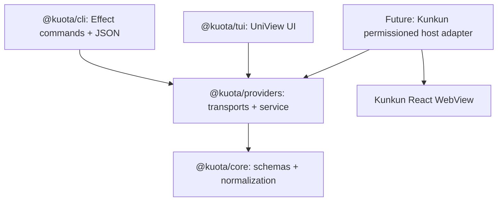

# Kuota Phase 2 — Reliable Quota Service, Credentials, and Kunkun Integration

- **Status:** Design proposal / implementation not started
- **Date:** 2026-11-06
- **Authoritative code location:** `/Users/hk/Dev/kuota` on HK's Mac mini
- **Audience:** Another implementation agent, reviewer, Kunkun integration agent
- **Sources:** [CodexBar](https://github.com/steipete/CodexBar), [UniView](https://github.com/HuakunShen/uniview), [Vite Plus](https://viteplus.dev/guide/monorepo), linked provider-specific references in `docs/research/2026-11-06-kuota-provider-research.md`.

> This document proposes new behavior; it is **not** evidence those features exist. `HANDOFF.md` and `docs/implementation-status-2026-11-05.md` distinguish implemented from planned. Do not change public JSON, read secrets, add dependencies, or launch browser authentication merely because a future design mentions them.

## 1. Product and user stories

Kuota is a **local-first quota observability library**, a noninteractive CLI, an optional UniView TUI, and ultimately a Kunkun plugin. The core use case: a developer runs multiple coding agents and wants to see **how much subscription quota remains in each window, when it resets, how fresh the observation is, and whether it can be trusted**. Quota is not interchangeable with token consumption, billing spend, or session progress.

1. **Headless/script:** `kuota status --json` returns a stable machine-readable envelope even when Claude is logged out or `agy` is missing. No browser, Keychain prompt, or model invocation.
2. **Interactive TUI:** launch once, refresh with `r` repeatedly; work stays responsive when a provider fails; do not hammer a private endpoint on every key press. Distinguish cached result, live result, and stale fallback.
3. **Kunkun plugin:** an explicitly permissioned background adapter exposes typed quota observations to a React WebView without giving the WebView OAuth tokens or arbitrary filesystem access.
4. **Future cloud reporting:** after the Kunkun account/privacy/sync design settles, allow **opt-in** periodic publication of redacted snapshot measurements, enabling daily quota history. No credentials ever leave the device. Cloud history is **not** a Phase 2 requirement.
5. **Multi-account:** when the underlying vendor can prove account identity, cache by account; when it cannot (notably current `agy -p /usage` payload), avoid persistent identity assumptions and cross-account joins.
6. **Offline/stale:** a cached valid success can remain visible with explicit age and an error indicator, rather than silently being presented as fresh; without a safe cached value, use an unavailable snapshot.

## 2. Existing implementation — verified, not speculative

| Package            | Current verified implementation                                                                          | Known limitation                                                                                             |
| ------------------ | -------------------------------------------------------------------------------------------------------- | ------------------------------------------------------------------------------------------------------------ |
| `@kuota/core`      | Effect Schema `ProviderId`, `QuotaStatus`, `QuotaWindow`, `QuotaSnapshot`; normalized used/remaining `%` | Static three IDs; no observation metadata or account identity                                                |
| `@kuota/providers` | Independent `readAll` adapters; Codex app-server, Claude OAuth usage, agy print                          | No singleflight, cache, cooldown, or persistent store                                                        |
| `@kuota/cli`       | Effect CLI `status`, `providers`, `doctor`, `tui`; schemaVersion 1 JSON                                  | Each invocation starts a **new OS process**; no warm in-process cache                                        |
| `@kuota/tui`       | UniView React TUI, keyboard `r/a/1/2/3/q`                                                                | Each refresh currently instantiates fresh providers and probes all sources; interactive manual smoke pending |

Mac mini baseline: `bun run test` passed 32/32 tests in 7 suites on 2026-11-05; build/typecheck/check previously passed. Codex and agy live reads worked. `claude auth status --json` said `loggedIn:false`; do **not** claim Claude live auth verified. `docs/implementation-status-2026-11-05.md` has the observed versions and caveats. Worktree was clean at start of design handoff. There is no configured remote Git repository.

## 3. Architecture and dependency rule



`core` MUST NOT import Node, Deno, CLI, UniView, or Kunkun. `providers` owns I/O, process lifecycle, credential source abstraction, refresh policy, and cache; it may depend on `core` and Effect. CLI/TUI depend on provider abstractions. Kunkun adapter depends on portable metadata/types and an explicitly authorized host-side provider runner; Kunkun desktop must not be a dependency of published `@kuota/core`/`@kuota/providers`.

### 3.1 Public data contract

Keep existing `QuotaSnapshot` **unchanged** in Phase 2 (schemaVersion 1 contract):

```ts
type ProviderId = "codex" | "claude" | "antigravity";
type QuotaStatus = "ok" | "partial" | "unauthenticated" | "unavailable" | "unsupported" | "error";
interface QuotaWindow {
  windowId: string;
  usedPercent: number | null; // [0, 100] or unknown
  remainingPercent: number | null; // [0, 100] or unknown
  resetAt: string | null; // UTC ISO timestamp when parseable
}
interface QuotaSnapshot {
  provider: ProviderId;
  status: QuotaStatus;
  fetchedAt: string; // source observation time
  source: string;
  windows: readonly QuotaWindow[];
  errorCode: string | null; // sanitized stable code, never vendor body
}
```

Introduce a separate **presentation/service wrapper**; do not append cache/account fields to `QuotaSnapshot` or silently reinterpret `status:"ok"` to mean fresh:

```ts
export interface QuotaObservation {
  snapshot: QuotaSnapshot;
  freshness: "live" | "cached" | "stale";
  observedAt: string; // original actual fetch timestamp
  checkedAt: string; // most recent probe attempt, including failed attempt
  ageMs: number; // derived from now - observedAt, nonnegative
  nextAttemptAt: string | null;
  latestErrorCode: string | null; // if stale success remained after an error
}
```

When the CLI eventually emits `QuotaObservation`, use an explicit **opt-in versioned envelope** e.g. `--format observation-json` or `schemaVersion:2` with documented migration; never mutate `schemaVersion:1` while old consumers exist. Default `status --json` continues to output `QuotaSnapshot[]`. Human/TUI may show the wrapper. The in-memory `now` used to compute `ageMs` must be injected into tests.

### 3.2 Provider identity and cache scope

Credential identity is sensitive and not universally available. Phase 2 service state is **process-local only** and indexed by current provider ID. This limits account confusion to account changes during a long-lived process; expose `invalidate(providerId)` for explicit account change/relogin. Never cache raw token, token hash, refresh token, cookies, stdout, or unredacted credential diagnostics. For account-specific persistent storage, first implement a reliable identity adapter with a **non-secret stable account identifier**, a user-visible account selector and verified rotation invalidation. No persistent cache for agy print-mode in Phase 2 because it lacks account identity.

### 3.3 Provider refresh policy

| Provider    | Success TTL (proposal) | Ordinary error retry |                             429 cooldown | Reason                                                        |
| ----------- | ---------------------: | -------------------: | ---------------------------------------: | ------------------------------------------------------------- |
| Codex       |                    60s |                  60s |                                   15 min | Local app-server; no need for multiple concurrent app-servers |
| Claude      |                 15 min |                  60s | 15 min, honor valid longer `Retry-After` | Private subscription API; avoid throttling and bans           |
| Antigravity |                  5 min |                  60s |                                   15 min | `agy` process cost and upstream auth/rate-limit exposure      |

Policies are conservative **defaults, not provider guarantees**. For `AUTH_REQUIRED`/unsupported version, prefer a longer 5-min retry if there is no signal the user logged in. A manual `--force` or TUI `r` may bypass **success TTL only**; it must **not** bypass an active rate-limit cooldown. For ordinary transient errors, `force` may bypass error backoff once; abort/retry storms need a guard. `Retry-After` parsing must accept seconds or HTTP date, clamp a defensible range, not trust invalid dates.

**Critical:** A process-local cache does not persist between `kuota status` commands (each command launches a fresh process). Do not market this feature as cross-process throttling. If the user wants safe OS-wide polling, decide later between: (A) simple durable cache with secure account identity; (B) one long-running local host daemon with UDS/Named Pipe; (C) Kunkun host runner as the shared process. None are authorized yet. The standalone CLI must remain useful without daemon or Kunkun.

### 3.4 Singleflight, stale, and cancellation

For the same provider and same process, simultaneous refresh calls join one in-flight promise; unrelated providers proceed independently with bounded overall concurrency (existing `readAll` uses 3). A failure must not poison the cache forever. After success and TTL expiry, retain only the **last successful normalized snapshot** for a bounded 24h display, marked `stale` with latest sanitized error. After 24h, return unavailable; never fabricate fresh remaining %. Time moving backwards clamps age to zero. If explicit invalidation happens during a request, the old response must not reinsert into cache; use per-provider generation counters. Aborting one caller must not inadvertently abort the shared refresh that other callers still await; document cancellation ownership.

### 3.5 CLI/TUI responsibilities

- **CLI**: `kuota status [--provider id] [--json]`, `providers`, `doctor`, `tui` remain stable. Introduce richer explicit `quota`/`watch`/`status --format ...` only when tests and migration exist. TTY gets human output; `--json` writes **exactly one** JSON object on stdout, no progress spinners. A missing provider returns its status without failing other sources. Respect `NO_COLOR` and non-TTY output.
- **TUI**: instantiate service **once** in `startTui`. `r` uses `force:true` subject to cooldown; avoid reentrancy, show `last updated`, `cached/stale`, reset time, keyboard help; provider filter must not trigger extra network. Add mock clock, mock providers, `MemoryCellSurface` snapshot tests. Manual Terminal.app smoke stays a required acceptance gate; remote process tool cannot allocate a real TTY.
- **Library**: normalize provider differences, expose read-only metadata and typed effects. Do not make consumers depend on the Kunkun plugin or run a shell through public data types.

## 4. Credential threat model and consent

**Threat actors/failures**: malicious provider stdout, injected ANSI escape sequences, compromised plugin iframe, leaked environment variables, user switching Claude accounts, accidental persistent token recording, private endpoint changes, Keychain access dialogs on a timer, unbounded `agy` children, repeated 429 requests.

**Trust boundary**: process runner and file credential reader live only in trusted host; renderer gets redacted windows and error codes. No raw HTTP body, stdout, stderr, secrets, account email, or command-line credential passed into structured logs, analytics, Drive, Kunkun cloud, repo fixtures, or user reports. File permissions and token scope must be respected; token acquisition may be refused without breaking Codex/agy.

Claude precedence proposed: explicit `options.token` for tests/opt-in API → explicit `options.credentialsFile` override → `CLAUDE_CODE_OAUTH_TOKEN` → default credential file. Current source uses env before `credentialsFile`, a testing/configuration pitfall. Include expiry guard with skew. No unattended login/refresh, no stealth Keychain reads. macOS Keychain access is a separate **user opt-in + security review gate**; if ever implemented, use macOS APIs in a dedicated host helper with UI disabled, or return `AUTH_REQUIRED`. The default cannot trigger a Keychain prompt or Claude login. `claude auth status --json` only verifies authentication state, not quota.

## 5. Kunkun plugin integration contract — conditional design

Your Kunkun v2.1 description uses native shell + React 19 WebView + a Deno permission broker. Public `kunkunsh/kunkun` branch observed in research also contains older Tauri/Svelte architecture. **Discovery gate:** before touching Kunkun, obtain the actual v2.1 checkout/commit, plugin manifest API, permission broker contract, Deno subprocess support, and WebView RPC. If unavailable, stop and ask HK to point to the current repo. Do not design against a guessed SDK.

Proposed local host-side commands:

```ts
type KuotaHostRequest =
  | { kind: "providers.list" }
  | { kind: "snapshots.read"; ids?: ProviderId[]; force?: boolean };
type KuotaHostReply =
  | { kind: "providers.list"; providers: ProviderMetadata[] }
  | { kind: "snapshots.read"; observations: QuotaObservation[] };
```

Permission grant is provider-scoped (`kuota.codex.read`, `.claude.read`, `.antigravity.read`) and explicit. Backend capabilities differ: Codex needs execute `codex` and stdio; agy execute `agy`, temp sandbox and local process; Claude reads a specific existing credential source and connects to a known HTTPS host. Denied capabilities map to per-provider `PERMISSION_DENIED`; no blanket `--allow-all`, no WebView filesystem bridge. `force` still obeys cooldown. Plugin renders in the app's existing React style; the adapter itself must remain usable as a standalone TS library/CLI without Kunkun.

**Distribution constraint:** Kunkun aims to avoid end-user npm installs. Decide between prebundled JS executed by existing Deno runner vs prebuilt standalone binary only after measuring runtime compatibility, artifact size, native child-process permissions, and OS path discovery. Neither approach should silently install third-party CLIs: Codex/agy are optional installed dependencies, with clear `doctor` guidance.

## 6. Proposed milestones and exit gates

| Milestone        | Deliverable                                                                   | Exit gate                                                                                           |
| ---------------- | ----------------------------------------------------------------------------- | --------------------------------------------------------------------------------------------------- |
| M1 (next)        | Singleflight TTL service, stale and rate-limit display                        | Unit tests with fake clock, no live service calls; TUI uses singleton; schemaVersion 1 unchanged    |
| M2               | Claude source precedence, bounded HTTP retry, consent-gated credential design | Fake-fetch tests, no leaked tokens, no Keychain or login side effects; live Claude remains optional |
| M3               | Robustness: agy child lifetime, CLI diagnostics, manual TUI                   | Mac mini smoke, failure injection, no orphan processes, 32 baseline tests plus new cases            |
| M4 (discovery)   | Kunkun v2.1 compatibility report, permission contract, architecture decision  | Actual repo commit and API references verified; user accepts permission UX                          |
| M5 (conditional) | Kunkun plugin bridge and React panel                                          | Plugin-level permissions tested, no secret in WebView, standalone CLI remains working               |
| M6 (future)      | Local history + account-aware cloud reports and dashboard                     | Privacy opt-in, data retention, per-device de-dup, cost estimates, sync architecture signed off     |

**Explicit exclusions now:** production service deployments, OAuth grant/refresher, bypassing 429 with proxy rotation, cross-device secrets, billing estimates presented as quota, agent task monitoring, Kunkun cloud cron jobs, npm release, GitHub repository creation/push. These need separate product/security decisions.

## 7. Validation matrix

| Mode                                 | Expected                                                         | Verification                  |
| ------------------------------------ | ---------------------------------------------------------------- | ----------------------------- |
| Test fixture: all healthy            | Each normalized window separately, valid percentages/reset times | `bun run test`                |
| Test fixture: Claude 401             | `unauthenticated/AUTH_REQUIRED`, no fake `0%`                    | focused Claude tests          |
| Test fixture: Claude 429             | cooldown, no forced re-probe until expiry                        | refresh service tests         |
| Test fixture: agy malformed          | isolated `PROTOCOL_ERROR`; no raw payload                        | agy parser tests              |
| Test fixture: Codex app-server exits | bounded error and child cleanup                                  | fake JSON-RPC transport tests |
| Concurrent `read`                    | Exactly one physical call per provider                           | singleflight tests            |
| Process restart                      | Cache cold, no guarantee of cross-process dedup                  | CLI process integration test  |
| TUI without TTY                      | clear error; one JSON stdout for CLI                             | CLI + TUI test                |
| TUI in Terminal.app                  | keyboard and redraw remain functional                            | manual smoke, record date     |
| Cloud/plugin                         | no network or account sync by default                            | permissions/egress checks     |

## 8. Decision log and review checklist

- **D1:** Keep `Kuota` name and CLI binary `kuota`; package split as already established.
- **D2:** Phase 2 read-only, no authentication mutation.
- **D3:** Cache in memory for long-running TUI/host, not durable cross-process.
- **D4:** Percentages are actual provider quota observations, no estimate when missing.
- **D5:** `@kuota/core` remains platform-agnostic; Node subprocess dependencies are in adapters only.
- **D6:** Kunkun is a consumer, not architecture owner of the core library.
- **D7:** JSON schema evolution is opt-in/versioned.
- **D8:** Claude Keychain read and background cloud report require explicit consent and separate plans.

Review for: mismatch with actual code, Effect error/cancellation semantics, late inflight invalidation, mock clock flakiness, account switching, secret disclosure in tests/fixtures, unjustified rate-limit numbers, actual Vite Plus build targets, UniView limitations, and Kunkun v2.1 SDK drift. Do not begin M4 implementation until the discovery gate clears.

## 9. How to hand off

Read, in order: `HANDOFF.md` → `docs/implementation-status-2026-11-05.md` → this spec → three actionable plan files in `docs/superpowers/plans` → `docs/research/2026-11-06-kuota-provider-research.md`. Execute **one checked-off task at a time**, with isolated tests and an explicit verification log. Commit changes locally after a passing slice; do not publish or push without HK's instruction.
